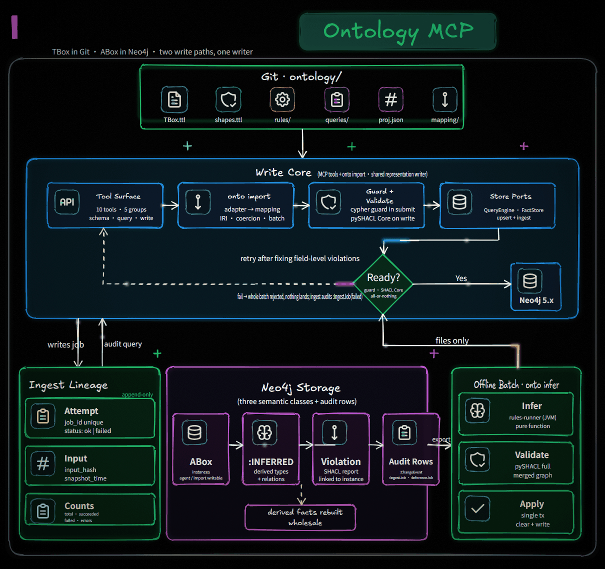
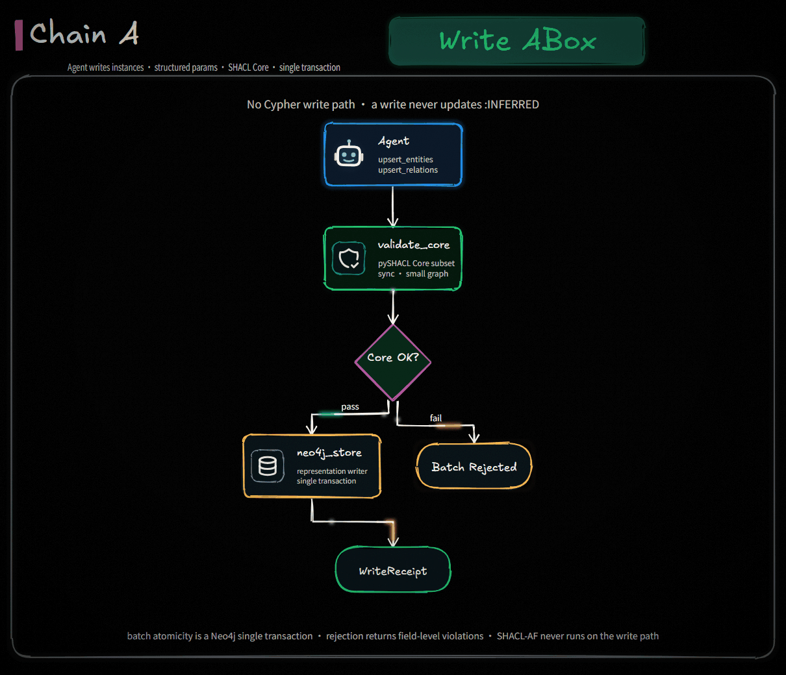
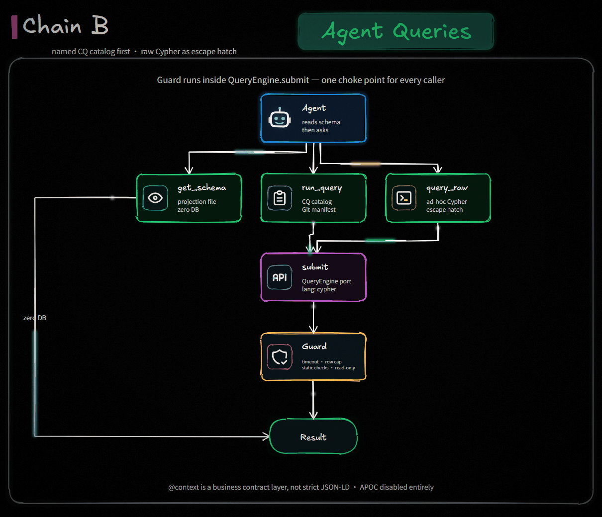
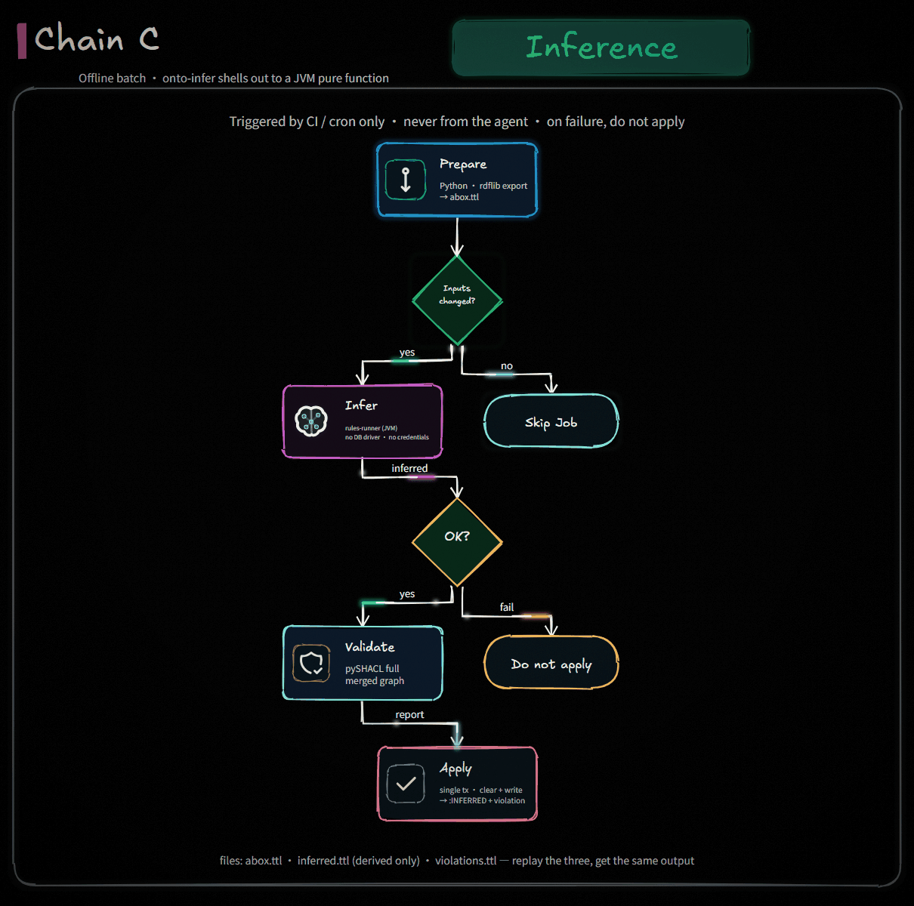

# fan-enterprise-ontology-mcp

**Making enterprise ontology simpler.** · 让企业本体更简单

An MCP server that exposes an enterprise ontology as an agent's semantic memory layer.

Agents read the ontology schema, query named competency questions or raw Cypher, write validated instance data, and consume offline-inferred derived facts — all as MCP tools.

**Language:** [English](README.md) · [简体中文](README_zh.md)

> **Status: draft.** Storage and query layer, agent integration, offline inference, SHACL validation are in scope for v1. Ontology alignment and knowledge extraction are planned, not built.

- **Protocol:** MCP (stdio)
- **Language:** Python (FastMCP) + JVM inference CLI
- **Storage:** Neo4j
- **Interchange:** Turtle / JSON-LD (RDF); tool results use a JSON-LD-aligned `@context`
- **Inference:** Jena rules (OWL 2 RL + business rules), offline
- **Validation:** pySHACL (SHACL Core at write time, full SHACL offline)
- **License:** [Apache License 2.0](LICENSE)

---

## Index

- [1. Overview](#1-overview)
- [2. Target Users & Scenarios](#2-target-users--scenarios)
- [3. Architecture](#3-architecture)
- [4. How it works](#4-how-it-works)
  - [Chain A — write ABox](#chain-a--agent-writes-abox)
  - [Chain B — agent queries](#chain-b--agent-queries)
  - [Chain C — offline inference](#chain-c--offline-inference-onto-infer)
- [5. Features](#5-features)
- [6. Tools](#6-tools)
- [7. Resources & Prompts](#7-resources--prompts)
- [8. Installation](#8-installation)
- [9. Configuration](#9-configuration)
- [10. Quick Start](#10-quick-start)
- [11. Security Model](#11-security-model)
- [12. Development](#12-development)
- [13. Testing & Acceptance](#13-testing--acceptance)
- [14. Limitations](#14-limitations)
- [15. Roadmap](#15-roadmap)
- [License](#license)

---

## 1. Overview

An enterprise ontology here is a structured business semantic model — classes, relations, properties, constraints, and axioms — plus the instance facts that conform to it. Its value over a plain property graph or text index is the **axioms and constraints**: the model can assert that "the head of a department is necessarily the owner of that department's work orders", and derived facts follow from it.

This project does not build a modeling environment. It makes a human-authored ontology (in Git) usable by agents at runtime, and keeps the instance store consistent with that ontology through validation and offline inference.

**TBox in Git, ABox in Neo4j.** The authoritative ontology is versioned Turtle/JSON-LD. Neo4j holds instances plus two derived artifact classes. The schema an agent reads is a flat projection generated from the TBox by CI.

---

## 2. Target Users & Scenarios

> Particularly suitable for regulated environments: state-owned enterprises, public institutions, and universities where auditability, standard semantics, and change traceability are required.

**Who this is for**

- **Knowledge / ontology engineers** who can author and maintain Turtle, SHACL shapes, and Jena rules. The TBox lives in Git and is human-owned.
- **Agent builders** on Claude Code, Codex, or a custom MCP client who need structured business facts rather than text retrieval.
- **Data governance / MDM teams** that need auditable, constraint-checked business facts with violations reported back.
- **Platform engineers** who already operate Neo4j and can run a JVM-side batch job.

**Use it when**

- An agent must answer business questions over entities and relations — contracts, customers, work orders, org structure — not over document text.
- Terms are ambiguous and the ontology has to pin them down (external customer vs. internal customer).
- Queries carry real business predicates: amount > 1M, not archived, owned by X, in department Y.
- Facts must be checkable and auditable, with constraint violations surfaced rather than silently stored.
- You want the ontology as an agent's semantic memory layer, not as a search index.

**Do not use it when**

- The task is document Q&A over unstructured text — use a vector store / RAG.
- You only need entity-relation storage with no axioms or constraints — a property graph with a light schema is cheaper.
- You need ontology alignment or knowledge extraction from source systems — out of v1 scope (see [Roadmap](#15-roadmap)).
- You need online OWL DL reasoning at request time — inference here is offline and batch.
- You have no JVM and cannot install Java — `onto infer` requires one.
- You need graphical ontology modeling — use Protégé. This project deliberately does not model.

---

## 3. Architecture



**Naming:** `onto infer` is the Python CLI users run (export → shell out to the JVM → validate → apply). `rules-runner` is the JVM pure function (`Turtle in → Turtle out`). Swapping the reasoner replaces `rules-runner` only; `onto infer` does not change.

**Deliverables**


| #   | Artifact                                         | Role                                                                                                                                                |
| --- | ------------------------------------------------ | --------------------------------------------------------------------------------------------------------------------------------------------------- |
| 1   | MCP server (Python)                              | Schema supply, query catalog, raw Cypher, controlled writes, write-time SHACL Core                                                                  |
| 2   | `onto infer` (Python CLI) + `rules-runner` (JVM) | Orchestrates export → JVM inference → validate → apply. **The JVM side holds no Neo4j driver, no DB credentials, and no write access** — files only |
| 3   | `ontology/` (Git)                                | TBox, shapes, rules, query catalog, schema projection (generated, CI-gated)                                                                         |
| 4   | Skills + MCP prompts                             | Claude Code skill wraps invocation habits; Codex reads MCP prompts/resources                                                                        |


> **`ontology/` ships a worked example, not your ontology.** The files here model
> one sample domain — enterprise contract management — so the server runs out of
> the box and the CI suite has something to regress against. Replace `TBox.ttl`,
> `shapes.ttl`, `queries/*.cypher` and `manifest.json` with your own; no Python
> changes are needed. After editing the TBox, run `onto project` to regenerate
> `schema.projection.json` (CI fails otherwise), and register every new query in
> `manifest.json` — `Catalog.load` cross-checks each entry's `uses` against the
> projection and refuses to start on a term that is not there.

### Data layout


| Location                                 | Content                                                                                                                                                           | Written by                                          |
| ---------------------------------------- | ----------------------------------------------------------------------------------------------------------------------------------------------------------------- | --------------------------------------------------- |
| Git `TBox.ttl` / `shapes.ttl` / `rules/` | Authoritative ontology and rules                                                                                                                                  | Human (Protégé / LLM + review)                      |
| Git `schema.projection.json`             | Flat **query-side projection** — classes, properties, relations, cardinality, core constraints. **Not the full set of OWL axioms, and never fed to the reasoner** | CI runs `onto project`; `git diff --exit-code` gate |
| Git `queries/*.cypher` + `manifest.json` | Query catalog = Competency Question set                                                                                                                           | Human + CI gate                                     |
| Neo4j ABox                               | Instances                                                                                                                                                         | MCP controlled ingest (agent-writable)              |
| Neo4j `:INFERRED` / `{inferred:true}`    | Derived types and derived relations                                                                                                                               | `onto infer` batch job                              |
| Neo4j `:ConstraintViolation`             | Offline SHACL violations, linked to the offending instance                                                                                                        | Same batch job, cleared and rebuilt                 |


**Three semantic node classes in Neo4j.** No TBox nodes, no schema nodes.

### Modeling contract

> v1 TBox is locked to the **Jena OWL 2 RL subset**. Do not introduce OWL DL constructs beyond RL. **Arithmetic business conditions live in Jena Rules, never in TBox axioms.**

This is checked mechanically in CI (see [Testing & Acceptance](#13-testing--acceptance)). It also settles reasoner selection: within RL, Jena rules is complete — no ELK, no HermiT in v1.

---

## 4. How it works

### Chain A — Agent writes ABox



1. Agent calls `upsert_entities` / `upsert_relations` with **structured parameters, not Cypher**.
2. `validate_core` runs the SHACL Core subset only: `sh:minCount`, `sh:maxCount`, `sh:datatype`, `sh:class`. It selects node shapes whose `sh:targetClass` matches the written types and runs on the affected subgraph only. Synchronous.
3. The representation writer assigns/reuses IRIs (the `uri` property is the entity unique key), maps properties to datatype vs. object properties, aligns labels with `rdf:type`.
4. Returns `WriteReceipt`: written IRIs, skipped items, validation summary.

Two hard constraints:

- **Batch atomicity is a Neo4j single transaction.** Whole batch commits or whole batch rolls back — database-level, not application-level. The API caps batch size and rejects oversized batches with a hint to split; chunked writes would break atomicity and are not offered.
- **Write does not update `:INFERRED`.** Derived facts stay stale until the next `onto infer` run (see [Staleness](#staleness-semantics)).

SPARQL-based SHACL (SHACL-AF) **never** runs on the write path — too slow, and write-time only answers "can this record enter".

### Chain B — Agent queries



Every response carries `@context`, `truncated`, `row_count`.

**`@context` is a business contract layer, not strict standard JSON-LD.** It exists so the agent understands entity semantics. It is not an RDF interchange format. Real JSON-LD / Turtle only travels over the file chain (`abox.ttl`, `inferred.ttl`, `violations.ttl`).

Errors are structured and actionable:


| code                  | `hint` gives                                                                   |
| --------------------- | ------------------------------------------------------------------------------ |
| `SCHEMA_NOT_FOUND`    | Run `search_schema`; nearest candidates                                        |
| `QUERY_SYNTAX`        | Neo4j's own message + "check labels and relationship names via `get_schema()`" |
| `QUERY_REJECTED`      | Which guard rule fired                                                         |
| `QUERY_LIMIT`         | Add `LIMIT`, narrow filters, use index-friendly predicates                     |
| `VALIDATION_FAILED`   | **Field-level** violations: shape / path / message / focus                     |
| `WRITE_REJECTED`      | Split into smaller batches                                                     |
| `BACKEND_UNAVAILABLE` | Retry later; no retry storm                                                    |


### Chain C — Offline inference (`onto infer`)

Four steps. **The JVM does only step 2.**



Order is not negotiable: validation must follow inference (otherwise derived facts are never checked); apply must be last (otherwise agents read half-built state).

### File contract


| File             | Content                                                       | Producer    |
| ---------------- | ------------------------------------------------------------- | ----------- |
| `abox.ttl`       | Full ABox as RDF                                              | `materialize_rdf` (rdflib) |
| `inferred.ttl`   | **Derived triples only — no original ABox**                   | JVM         |
| `violations.ttl` | SHACL violations: focus node IRI / shape IRI / path / message | pySHACL     |


`inferred.ttl` being incremental-only is mandatory. Without it `replace_derived` cannot tell derived from original and would delete real facts during rebuild. The JVM's output semantics is "triples produced by the rules and absent from the input graph".

### JVM never writes to Neo4j

> `rules-runner`'s JVM process **does not hold a Neo4j driver, does not hold DB credentials, and has no write access**. It reads and writes files only. The Python orchestration layer (`onto infer`) owns all writes.

Practical payoff: least privilege (an easier security review in regulated environments), JVM-side unit-testable without a database, reproducible inference (same inputs, same outputs), and swapping the reasoner means replacing step 2 only.

### Reproducibility

An inference job's inputs are fingerprinted and recorded on the single metadata node: git commit SHA of `TBox.ttl` / `rules/` / `shapes.ttl`, content hashes of `abox.ttl` / `inferred.ttl` / `violations.ttl` / `shapes.ttl`, the Neo4j version, and all counts.

- `onto infer` reads TBox/rules/shapes from a git checkout
- Dirty working tree → refuse to run; `--allow-dirty` runs and marks the metadata
- Reproducibility means: replaying the same three input files yields the same output

Using a newer TBox against an older ABox is normal ontology evolution, not a bug. The risk is leaving no trace; fingerprinting is what makes a run auditable.

### Staleness semantics

Between a write and the next `onto infer`, `:INFERRED` is stale. Three places handle this explicitly:

- Query results **do not hide** staleness. The agent decides whether the answer depends on derived facts.
- `replace_derived` writes a **singleton metadata node** (`job_id`, `finished_at`, input counts, derived count, violation count) so agents can ask how fresh the derived layer is. One node — not a fourth semantic class.
- Trigger cadence is an ops decision. Docs suggest a default (hourly, or debounced N minutes after writes); nothing is hard-coded.

### Known risk (spiked, not blocking)

`materialize_rdf` memory on large instance exports. If the spike shows it does not hold, the exporter loads the whole graph into one rdflib model; the fallback is a per-label partitioned export feeding the JVM multiple files. The contract assumes a single `abox.ttl` for now.

---

## 5. Features

### Schema supply (token-cost aware)

- `search_schema` / `get_schema` / `get_constraints` read from the flat projection file — zero database round-trips
- Result shapes are compact: class names, relation names, cardinality, core constraints
- The full projection is exposed only as a resource for humans and never enters a prompt

### Query catalog = Competency Questions

Named queries live in Git as parameterized Cypher with a manifest. The same artifact serves two purposes:

- **CI regression** — every PR runs the catalog against sample data and compares against expected results
- **Agent runtime** — `list_queries()` / `run_query(name, params)` for high-frequency intents

Raw Cypher (`query_raw`) remains the escape hatch for ad-hoc combinations.

### Controlled writes

Agents write instances through structured parameters. There is no Cypher write path, so the write-side injection surface does not exist. Write-time SHACL Core validation rejects non-conforming batches atomically.

### Offline inference with derived-fact isolation

Jena rules produce derived types and derived relations. They are materialized into Neo4j under an explicit marker and rebuilt wholesale per job, never mixed into the ABox.

### Violation reporting

Offline SHACL violations land in Neo4j as `:ConstraintViolation` nodes linked to the offending instance, so an agent can answer "what is wrong with this record" — not just "is something wrong".

---

## 6. Tools

Ten tools, five groups.


| #   | Tool                                   | Purpose                                                                 | Source                  |
| --- | -------------------------------------- | ----------------------------------------------------------------------- | ----------------------- |
| 1   | `search_schema(keywords, limit=20)`    | Keyword search over classes / properties / relations                    | Projection file         |
| 2   | `get_schema(entity_types[])`           | Full schema for given types: properties, cardinality, in/out relations  | Projection file         |
| 3   | `get_constraints(entity_types[])`      | SHACL **Core subset** constraints for pre-write judgment                | Projection file         |
| 4   | `list_queries(domain?)`                | List named queries (= CQs) with natural-language description and params | Manifest                |
| 5   | `run_query(name, params)`              | Run a named query                                                       | QueryEngine             |
| 6   | `query_raw(cypher, params)`            | Raw Cypher escape hatch (read-only + guard)                             | QueryEngine             |
| 7   | `upsert_entities(entities[])`          | Write instances (IRI reuse, properties, types)                          | validate → FactStore    |
| 8   | `upsert_relations(relations[])`        | Write relations                                                         | validate → FactStore    |
| 9   | `get_inference_status()`               | Derived-fact freshness                                                  | Singleton metadata node |
| 10  | `list_violations(focus_iri?, job_id?)` | Query SHACL violations                                                  | `:ConstraintViolation`  |


**There is no `load_ontology` tool.** The TBox is loaded through Git, not through MCP. That is a direct consequence of "TBox authoritative source is Git" — it removes a whole tool group and a whole attack surface.

### Tool contract

- Tool names, parameter names, and response shapes **do not change with the backend**
- New fields are additive; removals are marked `deprecated: true` for one release
- Swapping Neo4j for GraphDB requires **zero changes on the agent side**

### Boundaries worth stating

**`get_constraints` returns the Core subset only** (`minCount` / `maxCount` / `datatype` / `class`), for pre-write judgment. Responses carry `scope: "core"`. **Passing write-time validation guarantees only Core conformance** — SHACL-AF / SPARQL constraint violations surface at the next offline full validation, not at write time.

**`list_violations` defaults to the latest `onto infer` job**, aligned with `job_id` on the metadata node. In v1 the graph holds only the most recent batch (rebuilt wholesale), so the filter is currently equivalent to "all"; the optional `job_id` parameter exists for audit and run comparison.

---

## 7. Resources & Prompts

### Resources

```
ontology://catalog    Query catalog overview (light)
ontology://playbook   "How to query this ontology" — decision tree + error retry strategy
ontology://shapes     shapes.ttl source (human reference)
ontology://tbox       TBox.ttl source (human reference)
ontology://schema     Full projection (large; human reference only, never into a prompt)
```

### Prompts

- `query-playbook` — read schema → pick a named query → fall back to raw Cypher → retry on error
- `write-playbook` — write structure, how to fix validation failures, when derived facts update

### Claude Code vs. Codex


| Carrier            | Claude Code | Codex                    | Content                       |
| ------------------ | ----------- | ------------------------ | ----------------------------- |
| MCP tools          | yes         | yes                      | The capabilities themselves   |
| MCP resources      | yes         | implementation-dependent | playbook, schema              |
| MCP prompts        | yes         | implementation-dependent | the two playbooks             |
| Claude Code skills | yes         | **no**                   | Invocation-habit wrapper only |


**Knowledge lives in MCP resources and prompts** (at minimum `ontology://playbook`).
A skill is a thin wrapper — it must not restate the playbook, or the two will drift.
Otherwise Codex gets bare tools and nothing tells it "call `search_schema` first,
then `list_queries`, and only then `query_raw`".

The skill (`skills/feomcp/SKILL.md`) carries the trigger conditions, the order of
operations and the Claude Code habits that are not client-agnostic. Install it:

```bash
mkdir -p .claude/skills && cp -r skills/feomcp .claude/skills/   # this project
cp -r skills/feomcp ~/.claude/skills/                            # every project
```

---

## 8. Installation

### Prerequisites

- Python 3.12+
- Docker + Docker Compose (Neo4j stack and the test suite)
- Neo4j 5.x — Community is enough to develop against; **Enterprise is required if you
  want read/write account separation**, because RBAC (`CREATE ROLE` / `GRANT`) is an
  Enterprise feature

### Install

```bash
git clone https://github.com/yifanzhao2023/fan-enterprise-ontology-mcp.git
cd fan-enterprise-ontology-mcp
python -m venv .venv
.venv/bin/pip install -e ".[dev]"          # Windows: .venv\Scripts\pip install -e ".[dev]"
```

### Start Neo4j

```bash
docker compose up -d --wait
```

Brings up Neo4j 5.26 Community on `bolt://localhost:7687` (`neo4j` / `password`).
APOC is deliberately not installed: the Cypher guard rejects every `apoc.*` call, so
leaving the plugin out means the database cannot run one either.

### Build the schema projection

```bash
make projection
```

`schema.projection.json` is generated from `TBox.ttl` + `shapes.ttl`. **Commit it** —
CI fails when it is stale.

> **`ontology/` is a sample, not your ontology.**
> It holds a runnable domain — enterprise contract management — so the server starts
> out of the box and CI has something to regress against. It exercises six common
> situations on purpose: term disambiguation, named queries, multi-hop org traversal,
> a legal write, an illegal write, and a security boundary. Replace all of it with
> your own data before you use this for real. See
> [`ontology/README.md`](ontology/README.md) for how.

### Load the sample data(Optional)

```bash
make seed
```

Reads `ontology/abox.ttl` and writes it through the same representation writer the MCP
tools use. To replace the sample ontology with your own, see
[`ontology/README.md`](ontology/README.md).

### Build the derived layer

Derived facts (`:INFERRED`) are produced by an offline batch job, never by a tool call:

```bash
make infer
```

This exports the ABox, runs `ontology/rules/*.rules` in a JVM that has no database
access, validates the merged graph with SHACL, and replaces the derived layer in one
transaction. Check `get_inference_status()` before answering from a derived fact —
`stale: true` means something has been written since the last run. See
[`ontology/README.md`](ontology/README.md) section 13 for the scenarios that need it.

### Register with a coding agent

The server speaks MCP over stdio. The command is the console script inside your venv —
**use the absolute path**, because the agent's environment will not have your venv activated.

**Claude Code** — `.mcp.json` in the project root:

```json
{
  "mcpServers": {
    "feomcp": {
      "command": "/abs/path/to/.venv/bin/feomcp",
      "args": [],
      "env": {
        "FEOMCP_ONTOLOGY_DIR": "/abs/path/to/ontology",
        "FEOMCP_NEO4J_URI": "bolt://localhost:7687",
        "FEOMCP_NEO4J_USER": "reader",
        "FEOMCP_NEO4J_PASSWORD": "…",
        "FEOMCP_NEO4J_WRITE_USER": "writer",
        "FEOMCP_NEO4J_WRITE_PASSWORD": "…"
      }
    }
  }
}
```

or `claude mcp add feomcp -- /abs/path/to/.venv/bin/feomcp`.

**Codex** — `~/.codex/config.toml`:

```toml
[mcp_servers.feomcp]
command = "/abs/path/to/.venv/bin/feomcp"

[mcp_servers.feomcp.env]
FEOMCP_ONTOLOGY_DIR = "/abs/path/to/ontology"
FEOMCP_NEO4J_URI = "bolt://localhost:7687"
FEOMCP_NEO4J_USER = "reader"
FEOMCP_NEO4J_PASSWORD = "…"
```

**Any other MCP client** — stdio transport, command `feomcp` (equivalently
`python -m feomcp.server`).

> The server refuses to start when the query and write accounts are the same account.
> Give the query account `MATCH`-only privileges, or set
> `FEOMCP_ALLOW_SHARED_ACCOUNT=1` for development.

### Verify

```bash
make demo
```

Starts Neo4j, regenerates the projection, loads the sample ABox and runs every
competency question against its expected result.
## 9. Configuration

Environment variables. No config framework.

| Variable | Default | Purpose |
|---|---|---|
| `FEOMCP_STORE` | `neo4j` | Storage adapter |
| `FEOMCP_NEO4J_URI` | `bolt://localhost:7687` | Neo4j bolt URI |
| `FEOMCP_NEO4J_USER` | `neo4j` | Read-only account (query tools) |
| `FEOMCP_NEO4J_PASSWORD` | *(empty)* | |
| `FEOMCP_NEO4J_WRITE_USER` | *same as `FEOMCP_NEO4J_USER`* | Read-write account (write tools) |
| `FEOMCP_NEO4J_WRITE_PASSWORD` | *same as `FEOMCP_NEO4J_PASSWORD`* | |
| `FEOMCP_ONTOLOGY_DIR` | `ontology/` | TBox, shapes, queries, manifest, projection, ABox |
| `FEOMCP_QUERY_TIMEOUT_MS` | `10000` | Per-query timeout |
| `FEOMCP_MAX_ROWS` | `50` | Result row cap (also stops reading early) |
| `FEOMCP_MAX_QUERY_LENGTH` | `8192` | Query string length cap |
| `FEOMCP_MAX_BATCH` | `500` | Single write batch cap |
| `FEOMCP_REDACT_FIELDS` | *(empty)* | Comma-separated field names masked at read time |
| `FEOMCP_ALLOW_SHARED_ACCOUNT` | `0` | `1` permits query and write to share one account (development only) |

**Privilege separation is native database accounts**, not code branches. The server keeps
two driver sessions and routes by tool group: query tools (1–6, 9, 10) use the read-only
account, write tools (7, 8) use the read-write account.

`build_server` refuses to start when both point at the same account unless
`FEOMCP_ALLOW_SHARED_ACCOUNT=1` is set.

Defaults assume the `docker compose` stack. Production must set the account variables.

---

## 10. Quick Start

```bash
# 1. bring up Neo4j
docker compose up -d --wait

# 2. generate the schema projection and load the sample ABox
make seed

# 3. run every competency question against its expected result
make demo
```

Then point an agent at the server (see [Installation](#8-installation)) and ask a
business question. A good first one:

> Using the ontology, which contracts does customerA have that are over 1,000,000?

The agent should call `search_schema` / `list_queries` first, then
`run_query("contracts_over_amount_by_customer", {...})` — not write raw Cypher.

To see the tools without an agent:

```bash
.venv/bin/python -m feomcp.server      # starts the MCP stdio server
```

**This is a sample domain.** `ontology/` models enterprise contract management purely
so the stack runs out of the box — see [`ontology/README.md`](ontology/README.md) for
how to replace it with your own ontology.

---

## 11. Security Model

1. **Account separation** — read-only for query tools, read-write for write tools, no DB credentials in the JVM.
2. **Cypher injection** — `query_raw` parameters are always parameterized; string concatenation into a query is forbidden. The guard statically rejects `CREATE` / `MERGE` / `DELETE` / `DETACH` / `SET` / `REMOVE` / `DROP` / `LOAD CSV` / `dbms.*` / any `CALL` outside the whitelist. **APOC is disabled entirely** — `apoc.cypher.run` and relatives execute arbitrary Cypher strings and are code-execution escape hatches, not utilities.
3. **Whitelist is default-deny** and near-empty: built-in read-only functions only. Schema introspection goes through `get_schema()`, so nothing forces the whitelist open. Any procedure added later goes into an explicit config list, off by default.
4. **Resource caps** — query timeout, row cap, query length cap, write batch cap.
5. **Audit log** — `tool` / parameter digest / `principal` (caller identity: agent session ID or service account) / `timestamp` / `duration` / `row_count` / `ok`. Full result bodies are **not** logged.
6. **Field redaction at read time** — `FEOMCP_REDACT_FIELDS` masks values on query return. Storage keeps complete data; writes do not redact. Redaction covers violation details too (`list_violations` messages often embed field values). v1 is global config, not per-principal.
   ```
    # ponytail: field redaction + account separation + audit only; triple-level RBAC/ABAC
    # deferred until compliance requirements are concrete
   ```

    Full RBAC over triples is a large undertaking whose shape (row-level / field-level / attribute-based) must be driven by the business. v1 ships what is deployable and leaves the seam open rather than a fake RBAC.
7. **SHACL is not authorization.** SHACL governs data quality, not access control. Do not rely on it for permissions.
8. **Agents cannot trigger expensive operations.** There is no `rebuild_inferred` tool. Inference is triggered by CI or cron only.

### Failure handling


| Failure                                     | Handling                                                                       |
| ------------------------------------------- | ------------------------------------------------------------------------------ |
| Neo4j unavailable                           | `BACKEND_UNAVAILABLE`; no automatic retry storm                                |
| Projection missing or invalid               | **Refuse to start** (validated at boot)                                        |
| pySHACL throws                              | `VALIDATION_FAILED` with a truncated raw exception summary                     |
| JVM unavailable / timeout / inference fails | **Do not apply**; previous `:INFERRED` preserved; job metadata records failure |
| `abox.ttl` export fails                     | Same — do not apply                                                            |
| Apply transaction fails                     | Single transaction rolls back; previous derived data intact                    |
| Dirty git working tree                      | `onto infer` refuses; `--allow-dirty` runs and marks the metadata              |


**"On failure, do not apply" is the core invariant.** Old derived data beats no derived data, and beats a half-built one. Any step failing leaves the graph at the last successful job's state.

### Three invariants

1. A write either fully commits or fully disappears (Neo4j single transaction).
2. `:INFERRED` / `:ConstraintViolation` is always exactly one complete job's result — never a mixture.
3. The JVM process never holds database write access.

---

## 12. Development

### Repository layout

```
src/feomcp/           the MCP server and the offline chain
  ports.py            QueryEngine + FactStore protocols
  neo4j_store.py      the only adapter: driver, guard call site, representation writer
  schema.py           reads schema.projection.json
  catalog.py          named queries (the CQ catalog)
  validate.py         SHACL Core at write time, full SHACL offline, TBox profile gate
  guard.py            the Cypher trust boundary
  server.py           tool surface — the only exit
  cli.py              `onto project` / `onto seed` / `onto infer`
jvm/                  rules-runner: Turtle in, delta out. No DB, no network
ontology/             sample domain (replace it — see ontology/README.md)
  rules/*.rules       Jena rules; arithmetic business conditions live here
tests/                unit / integration / e2e
```

### Local development workflow

```bash
python3.12 -m venv .venv && . .venv/bin/activate
pip install -e ".[dev]"

make rules-runner     # build jvm/target/rules-runner.jar (needs JDK 17+ and Maven)
make unit             # no dependencies
make integration      # testcontainers, needs a running Docker daemon
make demo             # up + seed + infer + e2e against docker-compose
```

`make integration` and `make demo` need Docker. `make unit` does not — it is the
fast loop.

### Module boundaries (design summary)

Only two Python ports earn their interface — storage and query — because both have a planned second implementation. SHACL validation, projection reading, the query catalog, and the representation writer are concrete: a second implementation is not planned, and wrapping them would be tax paid to a hypothetical.

**Inference is a process boundary, not a Python interface.** Its contract is file exchange (`Turtle in → inferred.ttl out`). Swapping Jena for ELK means replacing `rules-runner`; the Python orchestration layer does not change.

---

## 13. Testing & Acceptance

### Test layers


| Layer         | Scope                                                                                                                                        | Depends on                    |
| ------------- | -------------------------------------------------------------------------------------------------------------------------------------------- | ----------------------------- |
| Unit          | `guard` (table-driven injection samples), `schema` / `catalog` parsing, `validate` Core judgments, `cli` apply logic against fake JVM output | nothing                       |
| Integration   | `neo4j_store`: upsert atomicity, representation writer, `materialize_rdf` round-trip, `replace_derived` rebuild                              | testcontainers (Neo4j) |
| End-to-end    | `make demo`: load sample → `onto infer` → all CQs → assert `sample_result`                                                                   | docker-compose                |
| CQ regression | Every manifest entry runs `sample_params` against `sample_result`                                                                            | same                          |


### CI gates (every PR)


| Gate                                       | Catches                                          |
| ------------------------------------------ | ------------------------------------------------ |
| `onto project` then `git diff --exit-code` | Projection drifting from Turtle                  |
| TBox profile check                         | OWL constructs beyond RL                         |
| SHACL validation of sample ABox            | Dirty sample data                                |
| `onto infer` runs                          | Broken rules                                     |
| All CQs vs `sample_result`                 | Ontology changes breaking queries                |
| manifest `uses` ⊆ projection               | Queries referencing deleted classes / properties |
| Unit + integration tests                   | Code regressions                                 |
| `make demo` full chain                     | Integration breaks                               |


**TBox profile check**: the modeling contract needs a machine check. Preferred implementation is an authoritative `OWL2RLProfile` check on the JVM side (the JVM is already there; the cost is one dependency), failing `onto infer` on violation.

Fallback: a Python-side constructor blacklist lint (disallow `owl:unionOf` / `owl:complementOf` / `owl:oneOf` / `owl:hasValue`, …) — a few dozen lines, **incomplete**.

```
# ponytail: prefer JVM-side OWL2RLProfile; blacklist lint is the no-JVM fallback only
```

### Error paths that must be tested

- Every guard rule has at least one sample (including escape hatches like `apoc.cypher.run`)
- `VALIDATION_FAILED` is field-level (shape / path / message / focus)
- **JVM failure does not apply** — previous `:INFERRED` intact
- Batch atomicity: half a batch invalid → nothing lands
- Timeout / row cap triggers
- Projection missing or invalid → refuse to start
- Dirty git tree → `onto infer` refuses

### Spike acceptance criteria

Spikes produce **conclusions and parameters**, not code. Conclusions are written into the design doc's verified section.


| Spike                 | Acceptance                                                                                                                 |
| --------------------- | -------------------------------------------------------------------------------------------------------------------------- |
| ABox round-trip       | `materialize_rdf` re-emits every entity, type, property and relation that was written (zero diff)                            |
| URI unique key        | the `uri` property as entity unique key; repeated writes are idempotent; no duplicate entities                             |
| Version compatibility | Neo4j 5.x stable for the read/write sessions and the derived-layer rebuild                                                 |
| Large instance export | 100k instances export without OOM; record duration and peak memory; fall back to paged / partitioned export past threshold |


### Metrics (POC thresholds, fixed)


| Metric                            | Threshold                                  |
| --------------------------------- | ------------------------------------------ |
| Named-query path success rate     | **≥ 99%**                                  |
| Raw Cypher path syntax pass rate  | ≥ 85% (**after one retry**)                |
| Raw Cypher execution success rate | ≥ 95%                                      |
| Answer correctness                | ≥ 90%                                      |
| CQ coverage                       | 100% on sample set, ≥ 90% on real ontology |
| SHACL violation rate              | < 1%                                    |
| Query P95                         | < 500 ms                                |
| Write validation P95              | < 200 ms                                |
| Schema tokens injected per call   | < 2000                                  |


The two query paths are measured separately so the value of the query catalog is visible. If the named-query path drops below 95%, the fix is more CQs — not tuning raw Cypher.

---

## 14. Limitations

- No modeling UI or domain modeling DSL. Use Protégé.
- No ontology alignment or knowledge extraction (planned).
- Inference is offline and batch; derived facts are stale between runs by design.
- TBox is restricted to the OWL 2 RL subset.
- Query results use a JSON-LD-aligned `@context`, not strict JSON-LD. RDF interchange only happens over the file chain.
- Field redaction is global config, not per-principal. Triple-level RBAC is not in v1.
- JVM required for `onto infer`.

---

## 15. Roadmap


| Item                                                  | Notes                                                                                                     |
| ----------------------------------------------------- | --------------------------------------------------------------------------------------------------------- |
| Ontology alignment & knowledge extraction         | New capability module; new tools + a package, reusing `FactStore.upsert` + `validate_core`                |
| GraphDB backend                                       | New adapter implementing `QueryEngine` / `FactStore`; tool schema unchanged; adds `submit(lang="sparql")` |
| OWL 2 EL + ELK                                        | When the TBox outgrows RL (large class hierarchies, equivalence, existential restrictions)                |
| Business-rule sync path (write-time rule application) | Small hand-maintained ruleset for derived facts needed immediately after a write                          |
| Triple-level RBAC / ABAC                              | Once compliance requirements are concrete                                                                 |
| OBDA / Ontop for relational sources                   | If data volume makes full extraction unattractive                                                         |


---

## License

Licensed under the [Apache License, Version 2.0](LICENSE).